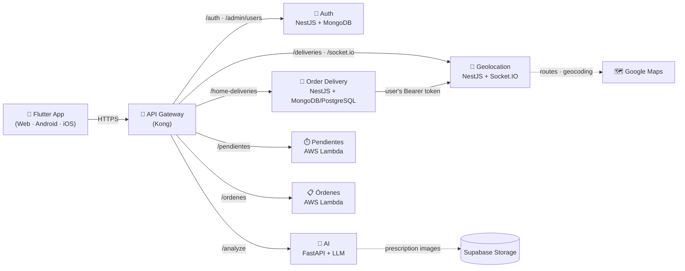
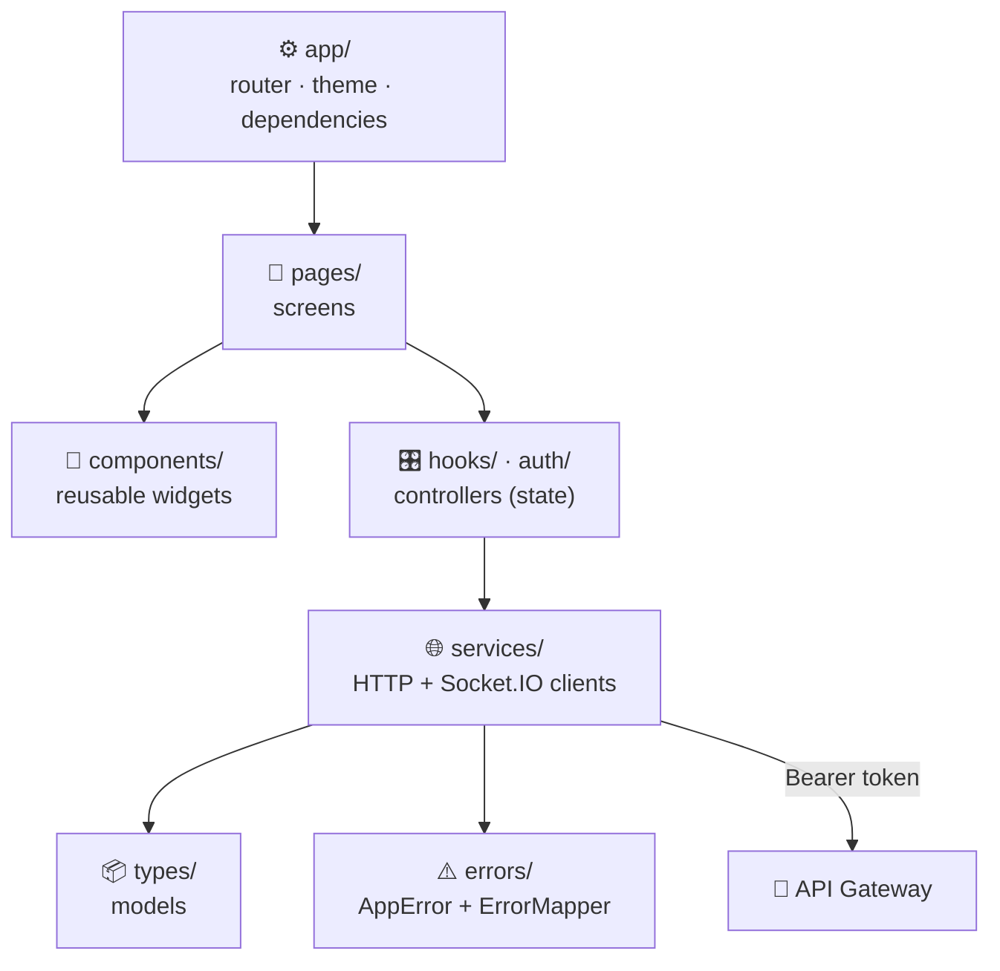
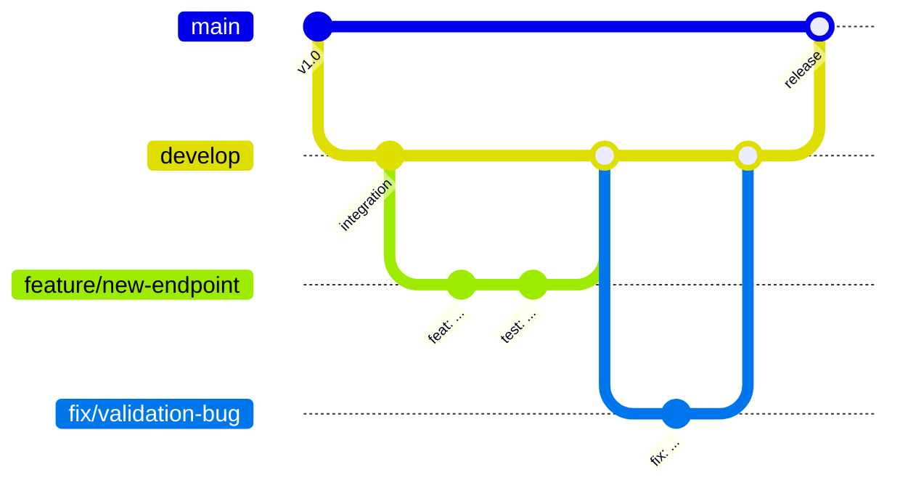

<div align="center">


# 📱 TheOff1ceFrontEnd

### The FarmaGo app — for patients, couriers, EPS staff and admins


**📸 Scan your prescription · 🛵 Get it delivered · 📍 Track it live**

</div>

---

## 📑 Table of Contents

1. [Overview](#-overview)
1. [📲 Install the App](#-install-the-app)
2. [The FarmaGo Ecosystem](#-the-farmago-ecosystem)
3. [Tech Stack](#️-tech-stack)
4. [Architecture](#️-architecture)
5. [Getting Started](#-getting-started)
6. [Configuration (`--dart-define`)](#️-configuration---dart-define)
7. [Backend Endpoints Used](#-backend-endpoints-used)
8. [App Screens (Routes)](#️-app-screens-routes)
9. [Pendientes (48-hour deadline)](#️-pendientes-48-hour-deadline)
10. [Home Delivery & Live Tracking](#-home-delivery--live-tracking)
11. [Build & Deploy](#️-build--deploy)
12. [Branch Strategy & Structure](#-branch-strategy--structure)

---

## 📖 Overview

**TheOff1ceFrontEnd** is the Flutter application of **FARMA GO**. Supported platforms: **Android, iOS and Web**.

| 👤 Role | What they can do |
|---|---|
| 🧑 **Patient** | Sign up / log in (email + code, or Google on web and on Android/iOS), analyze prescriptions with AI, see results, request home delivery, track the courier live, confirm delivery with a code, check their pending medications and medical orders. |
| 🛵 **Courier** (`DELIVERY_DRIVER`) | See available orders, take one, advance its status, share location while delivering. |
| 🏥 **EPS** | See assigned pending medications and register updates (novedades). |
| 👑 **Admin** | Manage users and roles, see and cancel any home-delivery order, follow any delivery. |

🔒 **No keys or secrets are ever configured in Flutter.** Auth's access token lives **only in memory** and is sent to every service as `Authorization: Bearer`.

---

## 📲 Install the App

| Device | How |
|---|---|
| 🤖 **Android** | Download `FarmaGo-vX.Y.Z.apk` from the [latest release](https://github.com/TheOff1ce/TheOff1ceFrontEnd/releases/latest) **on the phone**, open it and allow *Install unknown apps* for your browser when asked. |
| 🍎 **iPhone / iPad** | Open the web app in **Safari** → *Share* → **Add to Home Screen**. (A native iOS build needs a Mac and an Apple Developer account.) |
| 💻 **Desktop** | Open the web app in Chrome or Edge → install icon in the address bar (*Install FarmaGo*). |

### 🚀 Publishing a new version

1. Bump `version:` in `pubspec.yaml` (e.g. `1.0.1+2` — the number after `+` must always grow, or phones will refuse the update).
2. Tag and push:
   ```bash
   git tag v1.0.1
   git push origin v1.0.1
   ```
3. `.github/workflows/release.yml` runs the tests, builds the signed APK and publishes it as a **GitHub Release** with the file `FarmaGo-v1.0.1.apk`. It can also be run by hand from *Actions → Release → Run workflow*.

### 🔑 Signing (repository secrets)

Android only installs an update if it is signed with **the same key** as the installed app. The release key lives in `android/farmago-release.jks` + `android/key.properties` (both git-ignored — **back them up and never commit them**). For CI, add these secrets in *Settings → Secrets and variables → Actions*:

| Secret | Value |
|---|---|
| `ANDROID_KEYSTORE_BASE64` | The keystore in base64 (`[Convert]::ToBase64String([IO.File]::ReadAllBytes("android\farmago-release.jks"))` in PowerShell) |
| `ANDROID_KEYSTORE_PASSWORD` | `storePassword` from `android/key.properties` |
| `ANDROID_KEY_PASSWORD` | `keyPassword` from `android/key.properties` |
| `ANDROID_KEY_ALIAS` | `farmago` |
| `MAPS_API_KEY` | *(optional)* Google Maps client key restricted to `com.example.farma_go` + SHA-1 `12:FF:5A:11:F3:21:15:DE:84:02:E3:FC:98:41:FD:1E:81:B9:7F:20` |

Without the keystore secret, CI still publishes an APK, signed with a temporary debug key (it will not update an installed release build).

Local signed build: `flutter build apk --release` (uses `android/key.properties` automatically).

---

## 🧩 The FarmaGo Ecosystem

**FarmaGo** helps patients get their medications: they photograph a medical prescription, an AI reads it, and they can request home delivery and follow the courier live on a map. The platform is split into independent microservices behind a single API Gateway.



| Repository | Role |
|---|---|
| [TheOff1ceFrontEnd](https://github.com/TheOff1ce/TheOff1ceFrontEnd) | Flutter app for patients, couriers, EPS staff and admins |
| [TheOff1ceApiGateway](https://github.com/TheOff1ce/TheOff1ceApiGateway) | Single entry point (Kong), routing, load balancing, rate limiting |
| [TheOff1ceAuth](https://github.com/TheOff1ce/TheOff1ceAuth) | Sign-up, login with email code, Google OAuth, JWT, profiles, roles |
| [TheOff1ceAI](https://github.com/TheOff1ce/TheOff1ceAI) | Reads medications from a prescription photo with OpenAI / Gemini |
| [TheOff1ceOrderDelivery](https://github.com/TheOff1ce/TheOff1ceOrderDelivery) | Home-delivery board: patients request, couriers take orders |
| [TheOff1ceGeolocation](https://github.com/TheOff1ce/TheOff1ceGeolocation) | Live tracking: route, ETA, delivery status and courier location |

All services trust the same access token issued by **TheOff1ceAuth** (HS256 JWT, `iss=theoff1ce-auth`, `aud=theoff1ce-api`, 600 s lifetime).

---

## 🛠️ Tech Stack

| Layer | Technology |
|---|---|
| Framework | **Flutter** (stable, CI uses 3.47.8) + **Dart ≥ 3.3** |
| UI | **Material 3** with FarmaGo design tokens; font **Atkinson Hyperlegible Next** (SIL OFL) |
| Routing | **go_router** |
| HTTP | `http`, `http_parser` |
| Real time | `socket_io_client` |
| Maps & location | `google_maps_flutter`, `geolocator` |
| Camera & images | `camera`, `image_picker` |
| Storage | `flutter_secure_storage` |
| Others | `url_launcher`, `web`, `flutter_localizations` |
| Testing | `flutter_test`, `fake_async`, golden (visual) tests |
| CI/CD | **GitHub Actions** (analyze, test, build) + **Vercel** |

---

## 🏗️ Architecture

The app separates **UI** (pages and components), **state** (controllers in `hooks/`), **data access** (services and repositories) and **models** (`types/`).



### 📁 Folder structure

```text
lib/
├── main.dart
├── app/            # Theme (Material 3 tokens + farmago_tokens), router (go_router), routes, dependency composition
├── auth/           # Session (refresh every 600 s), password recovery, Auth repository
├── errors/         # AppError + ErrorMapper + Spanish messages (single place)
├── services/       # API clients with Bearer: auth, AI, orders, deliveries, ordenes, pendientes, admin;
│                   # HTTP helpers with timeouts, images, location, Maps loader (web/native)
├── hooks/          # Controllers: analysis, patient home, orders, driver board, tracking, admin, pendientes…
├── pages/          # One file per screen (login, home, upload, result, tracking, driver, admin…)
├── components/     # Reusable widgets
│   ├── farmago/    # Fg* design-system components (buttons, inputs, shell, badges, ordenes/…)
│   ├── pendientes/ # Pending-medication cards, table, detail panel
│   ├── landing/    # Landing page sections
│   └── account/    # Profile and password forms
├── notifications/  # Notification controller, model and repository
├── types/          # Models: auth, medication, analysis, order, delivery, ordenes, pendiente, admin…
└── utils/          # Constants (service URLs), validators, formatters, polyline decoding
assets/
├── fonts/          # Atkinson Hyperlegible Next (OFL)
└── images/         # FarmaGo logo, symbol, Google "G"
docs/               # Business context, identity manual, design notes
test/               # Unit, widget and golden tests
tool/               # Local server to test build/web (SPA routes)
scripts/            # vercel-build.sh
android/ ios/ web/  # Platform projects
```

### ✍️ Code conventions

| Rule | Why |
|---|---|
| **New code is written in Spanish** (classes, methods, variables, comments), like the design system (`FgCard`, `FgAccionTarjeta`, `AppNavigation.lateral`). Names imposed by Flutter, Dart or an API keep their own language (`build`, `onPressed`, `accessToken`). Existing English names are renamed only when that file is touched for another reason. | One language per concept avoids `_Contenido` next to `onTrack` |
| **One theme**: `AppTheme.light` (`lib/app/theme/app_theme.dart`), built from `farmago_tokens.dart`. No screen wraps itself in another `Theme`. | One source of truth for colors, type and components |
| **Design-system components only**: `FgButton`, `FgCard`, `FgTextField`, `FgBanner`… (`lib/components/farmago/`). No `FilledButton`/`TextButton` directly in pages. | Same look, press feedback and loading state everywhere |
| **Menu destinations live in `AppNavigation`** (`lib/app/app_navigation.dart`), for both the side bar and the bottom bar. | Adding a screen in one place updates every menu |
| Files over ~400 lines are split with `part` files by section. | Reviewable pull requests |

---

## 🚀 Getting Started

### Prerequisites

- 💙 **Flutter stable** (`flutter --version`)
- 🌐 Nothing else! By default the app uses the **deployed API Gateway**. To work against local services, run them (e.g. `docker compose -f docker-compose-up.yml up --build` from the FarmaGo root folder) and point the app to them.

### Prepare

```powershell
flutter pub get
flutter analyze
flutter test
```

### ▶️ Run

```powershell
# Web on a fixed port (needed for Google OAuth and so Auth accepts the origin)
flutter run -d web-server --web-hostname localhost --web-port 5173

# Web against local services
flutter run -d web-server --web-hostname localhost --web-port 5173 `
  --dart-define=API_BASE_URL=http://localhost:8000 --dart-define=AUTH_BASE_URL=http://localhost:3000

# Android Emulator (10.0.2.2 reaches your computer)
flutter run --dart-define=API_BASE_URL=http://10.0.2.2:8000 --dart-define=AUTH_BASE_URL=http://10.0.2.2:3000

# iOS Simulator
flutter run --dart-define=API_BASE_URL=http://localhost:8000 --dart-define=AUTH_BASE_URL=http://localhost:3000
```

In `TheOff1ceAuth`, `FRONTEND_URL` must be exactly the frontend origin (e.g. `http://localhost:5173`). The local Google redirect URI is `http://localhost:3000/auth/google/callback`.

---

## ⚙️ Configuration (`--dart-define`)

Every service URL defaults to the **API Gateway** (`https://farmago-gateway-jl.azurewebsites.net`). Override any of them with `--dart-define`:

| Variable | Service | Local example |
|---|---|---|
| `AUTH_BASE_URL` | 🔐 TheOff1ceAuth | `http://localhost:3000` |
| `API_BASE_URL` | 🤖 TheOff1ceAI | `http://localhost:8000` |
| `ORDERS_BASE_URL` | 🛵 TheOff1ceOrderDelivery (home deliveries) | `http://localhost:3002` |
| `GEOLOCATION_BASE_URL` | 📍 TheOff1ceGeolocation (REST + Socket.IO) | `http://localhost:3001` |
| `PENDIENTES_BASE_URL` | ⏱️ pendientes-service | `http://localhost:3003` |
| `ORDENES_BASE_URL` | 📋 ordenes-service (medical orders & EPS authorizations — not home deliveries) | `http://localhost:3004` |
| `MAPS_API_KEY` | 🗺️ Google Maps **client** key (optional) | — |

<details>
<summary>Direct deployed URLs (to bypass the gateway)</summary>

| Service | URL |
|---|---|
| Auth | `https://farmago-auth-jl.azurewebsites.net` |
| AI | `https://farmago-ai-jl.azurewebsites.net` |
| Geolocation | `https://farmago-geo-jl.azurewebsites.net` |
| Order Delivery | `https://domicilios-api.greenbeach-440c9bcb.brazilsouth.azurecontainerapps.io` |
| Pendientes (AWS Lambda) | `https://ey4bd7llo4despvmqbmxof6pfi0zoifk.lambda-url.us-east-1.on.aws` |
| Órdenes (AWS API Gateway) | `https://mtdviivm49.execute-api.us-east-1.amazonaws.com` (serves `/v1/ordenes`; the app uses the gateway's `/ordenes`) |

</details>

---

## 🔌 Backend Endpoints Used

| Service | Endpoints the app calls |
|---|---|
| 🔐 **Auth** | `POST /auth/signup` · `/auth/login` · `/auth/verify-code` · `/auth/resend-code` · `/auth/refresh` · `/auth/logout` · `/auth/forgot-password` · `/auth/verify-reset-code` · `/auth/reset-password` · `/auth/change-password` · `/auth/google/exchange` · `GET /auth/google` · `GET /auth/me` · `PATCH /auth/profile` |
| 👑 **Auth (admin)** | `GET /admin/users` · `PATCH /admin/users/:id/role` · `PATCH /admin/users/:id/document` |
| 🤖 **AI** | `POST /analyze` (multipart image) |
| 🛵 **Order Delivery** | `POST /home-deliveries` · `GET /home-deliveries/mine` · `POST /home-deliveries/:id/cancel` · `GET /home-deliveries/available` · `POST /home-deliveries/:id/take` · `GET /home-deliveries/taken` · `GET /home-deliveries/admin` |
| 📍 **Geolocation** | `GET /deliveries` · `GET /deliveries/:id` · `PATCH /deliveries/:id/status` · `POST /deliveries/:id/locations` · `POST /deliveries/:id/confirm` · Socket.IO `/tracking` (`subscribe`, `delivery.location`, `delivery.route`, `delivery.status`, `delivery.ended`, `session_expired`) |
| ⏱️ **Pendientes** | `GET /pendientes` · `GET /pendientes/:id` · `POST /pendientes/:id/novedades` |
| 📋 **Órdenes** | `GET /ordenes` · `GET /ordenes/:id` · `POST /ordenes/:id/domicilio/verificacion` · `POST /ordenes/:id/domicilio` |

---

## 🗺️ App Screens (Routes)

| Route | Screen | Role |
|---|---|---|
| `/` | Landing page | Public |
| `/login` · `/register` · `/verify-email` | Log in, sign up, email code | Public |
| `/forgot-password` · `/reset-password` | Password recovery | Public |
| `/auth/google/callback` · `/auth/callback` | Google sign-in return (web) | Public |
| `/completar-perfil` | Complete profile (required after sign-up) | All |
| `/home` | Home (adapts to the role) | All |
| `/analyze-prescription` → `/processing` → `/result` | Upload / photograph, analyze and review a prescription | Patient |
| `/orders` · `/orders/new` · `/orders/tracking/:deliveryId` | My deliveries, request delivery, live tracking | Patient |
| `/driver/orders` · `/driver/orders/:orderId` | Available deliveries and active delivery | Courier |
| `/pendientes` · `/pendientes/:pendienteId` | Pending medications (48 h) | Patient, EPS, Courier |
| `/ordenes` · `/ordenes/:ordenId` | Medical orders and authorizations | Patient |
| `/notifications` · `/account` | Notifications and account settings | All |
| `/admin/users` · `/admin/orders` · `/admin/orders/tracking/:deliveryId` | User management, all orders, tracking | Admin |

Old Spanish URLs (`/acceso`, `/registro`, `/inicio`, `/analizar-formula`…) redirect to the current ones.

---

## 🔑 Google Sign-In on Android and iOS

On the web, *Continuar con Google* redirects the page to TheOff1ceAuth as before. In the app:

1. It opens `GET /auth/google?platform=app` in an in-app browser tab (`flutter_web_auth_2`).
2. After Google, Auth returns to the app deep link `farmago://auth/callback#code=<one-time code>`.
3. The app trades the code with `POST /auth/google/exchange` and keeps the refresh token in secure storage.

Requires TheOff1ceAuth with `platform=app` support (deep link set by `GOOGLE_APP_REDIRECT_URL`, default `farmago://auth/callback`). The `CallbackActivity` for the `farmago` scheme is declared in `android/app/src/main/AndroidManifest.xml`; iOS needs no extra setup. Closing the tab simply returns to the login screen.

## ⏱️ Pendientes (48-hour deadline)

Screens of the `pendientes-service` microservice (`/pendientes` and `/pendientes/:id`), with Auth's access token in `Authorization: Bearer`:

- 🧑 **Patient**: *My pending items* (only theirs). 🏥 **EPS**: pending items assigned to them. 🛵 **Courier**: all of them (the backend still has to restrict it to their deliveries).
- List with filters (All / Pending / Delivered), search by order code and pagination. On mobile they are cards; from 768 px, a table whose detail opens in a side panel.
- Detail: 48-hour clock, status stamp, data, medications (approval and delivery) and updates. EPS and couriers can **register updates (novedades)**.
- The status (`VIGENTE`/`CUMPLIDO`/`INCUMPLIDO`) and the deadline are calculated by the backend; the frontend only presents them and anchors the clock to `evaluadoEn` (server time), not the device clock.

```powershell
# Against the deployed service (default)
flutter run -d web-server --web-hostname localhost --web-port 5173

# Against a local pendientes-service
flutter run -d web-server --web-hostname localhost --web-port 5173 `
  --dart-define=PENDIENTES_BASE_URL=http://localhost:3003
```

`pendientes-service` must allow the frontend origin (`FRONTEND_URL=http://localhost:5173`; in deployment, the `FRONTEND_URL` variable of the repository's `production` environment) and share `JWT_SECRET` with Auth.

🎨 These screens follow the **unified FarmaGo identity manual** (tokens in `lib/app/theme/farmago_tokens.dart`, `Fg*` components in `lib/components/farmago/`, Atkinson Hyperlegible Next font). The whole app shares this design system.

---

## 🛵 Home Delivery & Live Tracking

- 🧑 **Patient**: on Home, *Request medication at home* (pharmacy, address and products) and *My deliveries*. Each order opens **live tracking**: map with the route, the courier's location, the ETA and the status.
- Lists show the real delivery status (from Geolocation): *Looking for a courier*, *On the way*, *Delivered*… The patient can only cancel before the courier picks up the order, and the courier stops seeing finished deliveries in *My deliveries*.
- 🛵 **Courier**: *Available deliveries* to take an order, see what to pick up and where to deliver it, and advance the status (*I picked up the order* → *Start trip* → *Mark as delivered*). While carrying the order, the app sends its location **every 10 s** and stops when delivered.
- 🔢 **Delivery code**: the courier tells the patient a 6-digit code, and the patient types it to confirm the delivery.
- 🔌 Socket.IO: the token goes in the handshake (`auth.token`), never in the URL. If the token expires with the socket open, the app refreshes it and reconnects automatically.

```powershell
flutter run -d web-server --web-hostname localhost --web-port 5173 `
  --dart-define=API_BASE_URL=http://localhost:8000 --dart-define=AUTH_BASE_URL=http://localhost:3000 `
  --dart-define=ORDERS_BASE_URL=http://localhost:3002 --dart-define=GEOLOCATION_BASE_URL=http://localhost:3001 `
  --dart-define=MAPS_API_KEY=<client key, optional>
```

### 🗺️ Map

Without `MAPS_API_KEY` a simplified view is shown (route and points drawn, no tiles), enough to test with `MAPS_PROVIDER=fake` in Geolocation. With a key, `google_maps_flutter` is used. The client key is **different** from the server key:

| Platform | Where it goes | Google Cloud restriction |
|---|---|---|
| Web | `--dart-define=MAPS_API_KEY=...` (the app loads Maps JavaScript API) | *HTTP referrers* (`http://localhost:5173/*`, your domain) + only *Maps JavaScript API* |
| Android | `MAPS_API_KEY=...` in `android/local.properties` (not committed) | Android app (package + SHA-1) + only *Maps SDK for Android* |
| iOS | `MAPS_API_KEY=...` in `ios/Flutter/Secrets.xcconfig` (included by Debug/Release, not committed) | iOS app (bundle ID) + only *Maps SDK for iOS* |

⚠️ The client key must never have Routes or Geocoding enabled (only the backend uses those).

---

## ☁️ Build & Deploy

### Build for the web

```powershell
flutter build web --release --wasm
node tool/local_web_server.js   # local test of build/web with direct (SPA) routes on port 5173
```

### ▲ Vercel

`vercel.json` makes the project ready: `scripts/vercel-build.sh` downloads Flutter (`FLUTTER_VERSION`, default 3.47.8), builds to `build/web`, and every route rewrites to `index.html`. The project's environment variables in Vercel (`API_BASE_URL`, `AUTH_BASE_URL`, `PENDIENTES_BASE_URL`, `ORDERS_BASE_URL`, `GEOLOCATION_BASE_URL`, `ORDENES_BASE_URL`, `MAPS_API_KEY`) are passed as `--dart-define` only if they exist. The Vercel domain must be in Auth's and Pendientes' `FRONTEND_URL`.

`--wasm` makes browsers with WasmGC (recent Chrome, Edge, Firefox) load `main.dart.wasm` and the lighter `skwasm` renderer; the rest fall back to JavaScript + CanvasKit automatically. `web/index.html` shows a loading screen until Flutter paints its first frame.

You can publish `build/web` on any static hosting with a *fallback* to `index.html`. For the refresh cookie to work without cross-site mode, frontend and Auth should share a domain (e.g. `app.your-domain` and `auth.your-domain`).

### 🤖 CI (`.github/workflows/ci.yml`)

| Step | Runs on |
|---|---|
| `flutter analyze` → `flutter test --coverage` → `flutter build web --release --wasm` | Push to `main`, `develop`, `feat/**` and PRs to `main`/`develop` |
| Deploy to Vercel | After quality checks pass on `main` or `develop` |

---

## 🌿 Branch Strategy & Structure

We follow a lightweight **Git Flow**. Every change reaches `main` through `develop`, and every merge goes through a Pull Request.



| Branch | Purpose | Branches off | Merges into | Rules |
|---|---|---|---|---|
| 🟢 **`main`** | Stable, production-ready code. What is deployed. | — | — | Protected. Only receives merges from `develop` (or an urgent `fix/*`). Never commit directly. |
| 🔵 **`develop`** | Integration branch. The next release is assembled here. | `main` | `main` | Every feature and fix lands here first. Must always build and pass tests. |
| 🟣 **`feature/<name>`** | One new functionality (an endpoint, a screen, a route…). | `develop` | `develop` | Short-lived. One feature per branch. Delete after merging. |
| 🟠 **`fix/<name>`** | A bug fix. | `develop` (or `main` if urgent) | `develop` (and `main` if urgent) | Small and focused. An urgent fix merged into `main` is also merged back into `develop`. |

**Naming examples:** `feature/google-login`, `feature/delivery-tracking`, `fix/refresh-cookie`, `fix/analyze-timeout`.

### Workflow

```bash
git checkout develop && git pull                 # 1. Start from an up-to-date develop
git checkout -b feature/my-feature               # 2. Create your branch
git commit -m "feat: add my feature"             # 3. Commit with Conventional Commits
git push -u origin feature/my-feature            # 4. Push and open a PR → develop
# 5. Review + green CI → merge → delete the branch
# 6. When develop is stable → PR develop → main (release)
```

### Commit convention

We use [Conventional Commits](https://www.conventionalcommits.org/):

| Prefix | Use it for | Example |
|---|---|---|
| `feat:` | New functionality | `feat: add delivery confirmation code` |
| `fix:` | Bug fix | `fix: handle expired refresh token` |
| `docs:` | Documentation only | `docs: update endpoints table` |
| `refactor:` | Code change without new behavior | `refactor: split auth service` |
| `test:` | Adding or fixing tests | `test: cover role guard` |
| `build:` / `ci:` | Dependencies, Docker, pipelines | `ci: add health smoke test` |
| `chore:` | Maintenance | `chore: bump dependencies` |

---

<div align="center">

Made with 💚 by **TheOff1ce** · Escuela Colombiana de Ingeniería Julio Garavito

</div>
